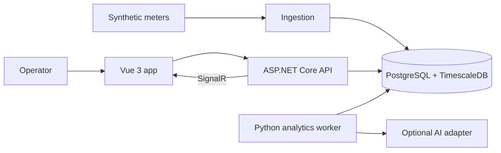

# GridWise

**Energy analytics for building operators.** GridWise turns raw smart-meter readings into live dashboards, flags abnormal consumption against a baseline, breaks costs down by tariff, and lets operators test how a schedule change would affect energy use and cost.

> **Status:** early development, following a 7-week roadmap (see below). The project uses only synthetic meter data and does not control any real equipment.

## The problem

Building operators can see raw meter readings, but they struggle to:

- spot abnormal consumption, like equipment left running overnight
- compare current usage against a sensible baseline
- understand what that usage actually costs under time-of-use tariffs
- predict the effect of changing an equipment schedule

GridWise answers these questions with deterministic analytics first and AI explanations second.

## Who it's for

- **Facility operators:** monitor sites live and respond to alerts
- **Energy analysts:** study baselines, anomalies and costs
- **Site managers:** review scenarios and approve recommendations
- **Administrators:** manage buildings, meters and access

## Demo workflow

1. Stream synthetic smart-meter readings
2. View the live site dashboard
3. Detect an overnight consumption anomaly
4. Inspect the tariff-based cost breakdown
5. Simulate an equipment schedule change
6. Approve a recommendation (advisory only, not sent to equipment)

## Planned features

- Buildings, meters and equipment registry
- Synthetic telemetry generator and ingestion
- Time-series charts and aggregation
- Meter data validation and deduplication
- Time-of-use tariff and cost calculation
- Baselines and anomaly detection
- Scenario comparison for schedule changes
- Real-time alerts with SignalR
- AI explanations grounded in measured readings
- Reporting, audit trail and retention controls

## Tech stack

| Layer | Technology |
|---|---|
| Frontend | Vue 3, TypeScript |
| API | ASP.NET Core, EF Core, SignalR |
| Analytics worker | Python |
| Database | PostgreSQL with TimescaleDB |
| Cache | Redis |
| Local environment | Docker Compose |
| CI | GitHub Actions |

## Architecture

Meter readings are validated and stored in TimescaleDB. The ASP.NET Core API serves dashboards and pushes live updates over SignalR. A Python worker computes baselines, anomalies and scenarios in the background.



### Planned repository layout

```text
gridwise/
├── apps/web/              # Vue 3 frontend
├── services/api/          # ASP.NET Core API
├── services/worker/       # Python analytics worker
├── packages/fixtures/     # synthetic meter data generator
├── infra/compose/         # local services
├── tests/                 # integration and end-to-end tests
└── docs/                  # architecture decisions and progress notes
```

## Design rules

- Duplicate meter readings never double-count consumption.
- Anomalies come from deterministic rules against a baseline; AI only explains them.
- AI explanations must cite actual measured readings.
- Recommendations are advisory. GridWise never controls real equipment.
- Permissions are enforced on the server for every site.

## Roadmap

| Week | Focus | Status |
|---|---|---|
| Week 1 | **Foundation** — Scaffold Vue and ASP.NET Core apps with Compose stack, add sample meter data generator with tests | ✅ Done |
| Week 2 | **Meters & ingestion** — Add identity and organizations, add buildings and meters, add TimescaleDB hypertable schema, add telemetry ingestion endpoint, add building and meter screens | Planned |
| Week 3 | **Data quality & live dashboard** — Deduplicate readings, flag gaps and spikes, add SignalR hub, add live dashboard | Planned |
| Week 4 | **Tariffs & costs** — Add time-of-use tariff model, calculate energy costs with tests, add cost report | Planned |
| Week 5 | **Anomalies & alerts** — Compute baselines in the worker, add deterministic anomaly rules, raise alerts from anomalies, add acknowledgment workflow, add alerts inbox | Planned |
| Week 6 | **Scenarios & AI** — Add versioned energy scenarios, add scenario comparison, add explanation adapter with mock model and evidence checks | Planned |
| Week 7 | **Release** — Add load and security tests, add build and test workflow, add setup guide, demo script and runbooks | Planned |

## Documentation

- [Architecture decisions](docs/adr/)
- [Week 1 acceptance cases](docs/acceptance/week-01-foundation-and-meter-fixtures.md)
- [Progress notes](docs/progress/week-01.md)
- [Synthetic meter data generator](packages/fixtures/README.md)

## Getting started

Setup instructions will be added once the first services are in place.
